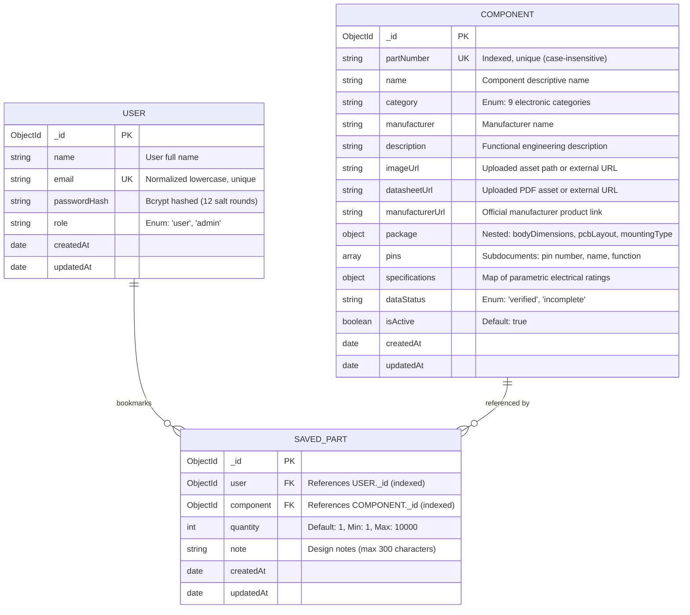

# Cirqon — Electronic Component Finder & PCB Design Assistant

> **EE4207 Web Application Development Mini Project**<br />
> **Student Developer:** D.P.L.C.L. De Silva<br />
> **Live Architecture:** React 19 (ES Modules, JSX) · Express.js 5 · Node.js · MongoDB Atlas · Mongoose 9

---

## 1. Project Overview

**Cirqon** is an engineering-grade web application tailored for electronics students, PCB designers, and hardware engineers. It provides an intuitive, high-performance platform to search, filter, compare, and audit electronic components alongside an interactive CAD PCB Footprint Visualizer and personal engineering workspaces.

### The Problem It Solves
Hardware engineers and electronics students frequently struggle with scattered datasheets, incompatible footprints, and fragmented component catalogs. Cirqon unifies parametric electrical search with mechanical CAD package auditing and role-based component administration, ensuring accurate part selection before fabricating printed circuit boards.

---

## 2. EE4207 Evaluation Rubric Alignment

| Rubric Criteria | Allocated Marks | Cirqon Implementation Highlights |
| :--- | :---: | :--- |
| **Create (CRUD)** | **4 Marks** | Admin interface (`/admin/components`) with client & server validation, file uploads (JPG/PNG/WebP, PDF datasheets), and persistent MongoDB Atlas storage. |
| **Read (CRUD)** | **4 Marks** | Fast catalog search (300ms debounce), multi-category filtering, column sorting, single-item technical details modal, and side-by-side comparison matrix. |
| **Update (CRUD)** | **4 Marks** | Full component modification with pre-filled forms, mass-assignment defense, and defensive partial subdocument merging preserving CAD geometries. |
| **Delete (CRUD)** | **4 Marks** | Safe deletion workflow with explicit confirmation dialog, automatic cascade deletion of referencing user bookmarks, and disk asset cleanup. |
| **Validation & Error Handling** | **2 Marks** | Dual client-server validation boundaries, regex-checked case-insensitive unique MPNs, HTTP 400/401/403/404/409 error codes, and React Error Boundaries. |
| **Database Design** | **4 Marks** | Mongoose schemas with type safety, enum constraints, compound unique indexes, subdocuments, and referential integrity between `User`, `Component`, and `SavedPart`. |
| **UI/UX & Responsiveness** | **2 Marks** | Professional engineering palette (CSS Design Tokens), responsive layout across 360px–1280px+, accessible modals, and custom interactive SVG CAD viewers. |
| **Code Quality & Structure** | **2 Marks** | 100% pure JavaScript/JSX ES Modules, clean separation of concerns (`auth`, `components`, `pages`, `models`, `routes`), and comprehensive viva documentation. |
| **Documentation** | **2 Marks** | Comprehensive README, setup instructions, Mermaid ERD, REST API documentation, and security rationale. |
| **Demonstration** | **2 Marks** | Structured 5-minute evaluation demonstration script covering all required rubric workflows. |
| **Total Marks** | **26 / 26** | **Full Rubric Compliance** |

---

## 3. Technology Stack

- **Frontend:** React 19, React Router 7, Vite 8, Lucide React icons
- **Styling:** Vanilla CSS leveraging a centralized Design Tokens architecture (`tokens.css`)
- **Backend:** Node.js, Express.js 5 (REST API, Router, Custom Middleware)
- **Database & ODM:** MongoDB Atlas (Cloud Cluster), Mongoose 9
- **Authentication & Security:** JSON Web Tokens (JWT), Bcrypt.js (12 salt rounds), Multer with MIME/Magic-byte inspection
- **Development & Tooling:** ESLint 10, Nodemon, Git

---

## 4. Database Design & Entity-Relationship Diagram (ERD)

Cirqon enforces referential integrity and strict typing using Mongoose. The database consists of three core collections:



### Referential Integrity & Cascade Deletion
- **Compound Unique Index:** `SavedPart` enforces `{ user: 1, component: 1 }` with `unique: true`, preventing duplicate bookmarks by the same engineer.
- **Cascade Cleanup:** Deleting a `Component` document automatically invokes `SavedPart.deleteMany({ component: id })`, eliminating orphaned records and preventing `null` reference errors when calling `.populate("component")`.

---

## 5. Prerequisites & Environment Setup

### Prerequisites
- **Node.js:** v18.0.0 or later (v20+ recommended)
- **npm:** v9.0.0 or later
- **MongoDB:** Active MongoDB Atlas cluster URI or local MongoDB instance (`mongodb://localhost:27017/cirqon`)

### Step 1: Clone the Repository
```bash
git clone https://github.com/nadun-theekshana/Cirqon.git
cd Cirqon
```

### Step 2: Configure Environment Variables

#### Backend (`server/.env`):
Create a `.env` file inside the `server/` directory:
```env
PORT=5000
MONGODB_URI=mongodb+srv://<username>:<password>@cluster0.example.mongodb.net/cirqon?retryWrites=true&w=majority
JWT_SECRET=cirqon_super_secure_jwt_secret_key_2026
```

#### Frontend (`client/.env`):
Create a `.env` file inside the `client/` directory (optional for default localhost):
```env
VITE_API_BASE_URL=http://localhost:5000/api
```

---

## 6. Installation & Execution Guide

### Backend Setup
1. Navigate to the server folder and install dependencies:
   ```bash
   cd server
   npm install
   ```
2. Populate the component catalog with verified seed data:
   ```bash
   node seedComponents.js
   ```
3. Start the Express API server:
   ```bash
   npm run dev
   # Server runs on http://localhost:5000
   ```

### Frontend Setup
1. Open a new terminal, navigate to the client folder, and install dependencies:
   ```bash
   cd client
   npm install
   ```
2. Run the frontend development server:
   ```bash
   npm run dev
   # Client runs on http://localhost:5173
   ```
3. Run the production build or linter:
   ```bash
   npm run build
   npm run lint
   ```

---

## 7. Administrative User Setup & Demo Credentials

Cirqon implements strict **Role-Based Access Control (RBAC)**. Public registration (`POST /api/auth/register`) hardcodes `role: "user"` to prevent privilege escalation.

### Promoting a User to Administrator
To grant admin privileges for evaluating the CRUD operations:
1. Register a user in the web application (e.g. `alex@cirqon.org`).
2. Run the out-of-band administrative provisioning script from the server folder:
   ```bash
   node server/scripts/makeAdmin.js alex@cirqon.org
   ```

### Evaluator Credentials
- **Admin Account (for CRUD Evaluation):** `alex@cirqon.org` (Role: `admin`)
- **Engineer Account (for Workspace Evaluation):** `test1@cirqon.org` (Role: `user`)

---

## 8. REST API Reference

All write endpoints require a JSON Web Token in the `Authorization: Bearer <token>` header.

| Method | Endpoint | Access Level | Description |
| :--- | :--- | :--- | :--- |
| **GET** | `/api/components` | Public | List components with optional query parameters (`search`, `category`, `manufacturer`, `package`). |
| **GET** | `/api/components/:id` | Public | Retrieve detailed component specifications by MongoDB ObjectId. |
| **POST** | `/api/components` | Admin | Create a new component. Validates required fields, enum taxonomy, and case-insensitive unique MPN. |
| **PUT** | `/api/components/:id` | Admin | Update component attributes. Whitelists inputs and preserves CAD geometries. |
| **DELETE** | `/api/components/:id` | Admin | Permanently delete a component, cascade cleanup referencing bookmarks, and remove uploaded disk files. |
| **POST** | `/api/uploads/image` | Admin | Upload component product image (JPG/PNG/WebP, max 2 MB). |
| **POST** | `/api/uploads/datasheet` | Admin | Upload official PDF datasheet (PDF only, max 10 MB). |
| **POST** | `/api/auth/register` | Public | Register a new user account with bcrypt password hashing (12 rounds). |
| **POST** | `/api/auth/login` | Public | Authenticate user and issue signed JWT bearer token. |
| **GET** | `/api/auth/me` | Authenticated | Verify session token and retrieve current user profile. |
| **GET** | `/api/saved-parts` | Authenticated | Retrieve bookmarked parts for the authenticated user. |
| **POST** | `/api/saved-parts` | Authenticated | Bookmark a component in user workspace (`{ componentId }`). |
| **PUT** | `/api/saved-parts/:componentId` | Authenticated | Update quantity (1–10,000) and design notes (max 300 chars). |
| **DELETE** | `/api/saved-parts/:componentId` | Authenticated | Remove component bookmark from user workspace. |

---

## 9. Security & Defensive Design Architecture (Viva Highlights)

1. **Defense-in-Depth Validation:** Client-side validation (`AdminComponentsPage.jsx`) provides instant visual feedback, while authoritative server-side validation (`componentRoutes.js`) verifies all constraints.
2. **Mass-Assignment Defense (CWE-915):** The server explicitly extracts whitelisted properties (`extractWhitelistedComponentFields`). Malicious injected parameters (e.g., `_id`, `createdAt`, `role`) are silently discarded.
3. **Stateless JWT Authorization:** Tokens carry cryptographically signed user payloads. `requireAuth` verifies the HMAC signature, while `requireAdmin` checks role permissions.
4. **Storage Hygiene & Path Traversal Prevention:** Uploaded files receive cryptographically random UUIDs (`crypto.randomUUID()`). File deletions resolve paths strictly within `server/uploads/` to defeat `../` directory traversal attacks.
5. **Magic Byte Inspection:** File uploads inspect both the HTTP Content-Type header and binary magic byte signatures (`FF D8 FF` for JPEG, `89 50 4E 47` for PNG, `%PDF-` for PDF) to reject renamed executables.
6. **Graceful Error Containment:** All server routes return structured JSON errors without exposing server stack traces, database connection URIs, or internal system paths.

---

## 10. Five-Minute Project Demonstration Walkthrough

Follow this step-by-step sequence during your project evaluation to demonstrate all rubric criteria:

### Minute 1: Problem Statement & Brand Identity
- Open `http://localhost:5173/` in your browser.
- Point out the clean single-column hero section with the dark-overlay circuit canvas and typography-styled Cirqon wordmark.
- Highlight the real-time category counter pills showing live counts queried directly from MongoDB Atlas.

### Minute 2: Component Library & Parametric Discovery (Read)
- Click **Library** in the navbar (or press `/` from anywhere on the page to focus the search bar).
- Type `"LM358"` to show live 300ms debounced search filtering.
- Select category pills (e.g. *Integrated circuits (ICs)*) and switch between **Grid View** and **Table View**.
- Click on any component card to open the **Component Details Modal**. Walk through the General Information, Electrical Specifications, Pinout Table, and official Datasheet link.

### Minute 3: PCB Design Assistant & Footprint CAD Inspection
- Click **View in PCB Assistant** from the modal (or click **PCB Assistant** in the top navigation).
- Demonstrate the interactive SVG CAD canvas rendering physical body boundaries, copper pads, lead pitch, and pin labels.
- Point out the **Footprint Validation Panel** executing 8 physical rule checks (package identity, lead pitch, drill diameter, mounting type) capped at Illustrative status for engineering integrity.

### Minute 4: Component Comparison & Engineer Workspace
- Navigate to **Compare** and select 2–4 parts (e.g., LM358 vs NE555).
- Highlight the **DIFF badges** that automatically flag divergent electrical specifications (e.g., channel count, supply voltage).
- Log in as an engineer (`test1@cirqon.org`), click **Save Part**, navigate to **My Parts**, and edit the order quantity and design notes to show persistent workspace updates.

### Minute 5: Administrative Component CRUD & MongoDB Persistence (Create, Update, Delete)
- Log in as an administrator (`alex@cirqon.org`) and click **Manage** in the navbar.
- **Create:** Click **Add Component**, enter a new test part (e.g., `MCP6002`, Microchip, IC, SOIC-8), upload a datasheet or image, and click **Create Component**. Show the green success banner.
- **Persistence:** Switch to the **Library** view to prove the newly added component appears immediately in the catalogue and updates the category count without refreshing.
- **Update:** Return to **Manage**, click **Edit** on the newly created part, change its name, and save.
- **Delete & Cascade:** Click **Delete**, highlight the confirmation modal warning that user bookmarks will be cascaded, and confirm. Verify the item is removed and that no orphan bookmarks remain in MongoDB.
