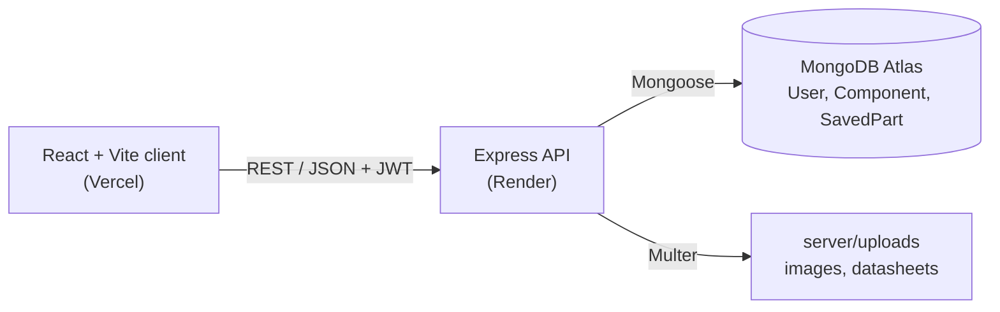

# Cirqon — Electronic Component Finder and PCB Design Assistant

Cirqon is a MERN web application for electronics students and designers. It brings component records, specifications, datasheet links and footprint information into one searchable catalogue, and it includes a PCB Design Assistant that shows how reliable each footprint's data is.

Developed for **EE4207 – Web Application Development Mini Project**, University of Ruhuna.

- Live application: https://cirqon-xi.vercel.app
- Backend API: https://cirqon-api.onrender.com

## Key Features

- **Component catalogue:** browse by category, search by part number, name or manufacturer, sort, and switch between card and table views. The catalogue contains 11 components in 9 categories.
- **Component details:** specifications, pinout, package information, and datasheet and manufacturer links.
- **Component management (CRUD):** admins create, edit and delete components from the Manage page, with client-side and server-side validation. Duplicate part numbers are rejected (HTTP 409).
- **Authentication and roles:** register and log in with JWT. New accounts always get the `user` role. Admin-only routes return 401 without a token and 403 for non-admin users.
- **Saved parts:** logged-in users save components to *My Parts* and edit a quantity and a note.
- **Compare:** select several components and compare their specifications side by side, with differing rows highlighted.
- **PCB Design Assistant:** interactive SVG footprint viewer (zoom, pan, measure, millimetre grid, pad table). Each value is labelled *Catalogue*, *Derived*, *Placeholder* or *Not available*, and a validation panel marks each footprint *Verified*, *Illustrative* or *Incomplete*. Footprints are not drawn when the required data is missing.
- **File handling:** admins can upload component images (JPG, PNG or WebP, up to 2 MB) and PDF datasheets (up to 10 MB). Uploads get random file names and the file signature is checked on the server.
- **Responsive interface:** layout adapts to phone and desktop widths; styling uses shared CSS design tokens.

## Technology Stack

| Layer | Technologies |
| :--- | :--- |
| Frontend | React 19, JavaScript (JSX), Vite, React Router, CSS, Lucide icons |
| Backend | Node.js, Express 5, JSON Web Tokens, bcryptjs, Multer |
| Database | MongoDB Atlas, Mongoose |
| Deployment | Vercel (frontend), Render (backend) |
| Tooling | ESLint, Nodemon, Git and GitHub |

## System Architecture

The React app runs in the browser and calls the Express REST API over HTTPS. The API checks authentication and roles, validates input, and reads and writes MongoDB Atlas through Mongoose models. Uploaded files are stored in `server/uploads` and served from `/uploads`.



### Database

| Collection | Main fields |
| :--- | :--- |
| `User` | name, email (unique), passwordHash, role (`user` or `admin`), timestamps |
| `Component` | partNumber (unique), name, category (9 allowed values), manufacturer, description, imageUrl, datasheetUrl, manufacturerUrl, specifications, package, pins, dataStatus (`verified` or `incomplete`), isActive, timestamps |
| `SavedPart` | user (ref), component (ref), quantity (1–10000), note (max 300 characters), timestamps |

A user can save many components and a component can be saved by many users, so `SavedPart` links the two. A unique index on `(user, component)` prevents duplicate saves, and deleting a component also deletes its `SavedPart` records.

### API Summary

Write routes need the header `Authorization: Bearer <token>`.

| Route | Access |
| :--- | :--- |
| `POST /api/auth/register`, `POST /api/auth/login` | Public |
| `GET /api/auth/me` | Logged-in user |
| `GET /api/components`, `GET /api/components/:id` | Public |
| `POST /api/components`, `PUT /api/components/:id`, `DELETE /api/components/:id` | Admin |
| `POST /api/uploads/image`, `POST /api/uploads/datasheet` | Admin |
| `GET`, `POST /api/saved-parts`; `PUT`, `DELETE /api/saved-parts/:componentId` | Logged-in user |

## Project Structure

```text
Cirqon/
├── client/                  # React + Vite frontend
│   └── src/
│       ├── components/      # common, layout, library, compare, pcb
│       ├── context/         # AuthContext, SavedPartsContext
│       ├── pages/           # Home, Login, Register, MyParts, admin/Manage
│       ├── utils/           # footprint logic and formatters
│       ├── styles/          # design tokens
│       └── tests/           # footprint validation tests
├── server/                  # Express API
│   ├── models/              # User, Component, SavedPart
│   ├── routes/              # auth, components, saved parts, uploads
│   ├── middleware/          # JWT and admin checks
│   ├── scripts/             # seedComponents, makeAdmin, updateImages
│   ├── tests/               # footprint validation test
│   └── server.js
├── docs/                    # image checklist
└── scripts/                 # helper script for component images
```

## Installation and Setup

**Prerequisites:** Node.js (current LTS recommended), npm, Git, and a MongoDB Atlas cluster or a local MongoDB instance.

1. Clone the repository:

   ```bash
   git clone https://github.com/Chethiya283/Cirqon.git
   cd Cirqon
   ```

2. Create the environment files (see the next section), then install and start the backend:

   ```bash
   cd server
   npm install
   node scripts/seedComponents.js   # optional: loads the 11 catalogue components
   npm run dev                      # http://localhost:5000
   ```

3. In a second terminal, install and start the frontend:

   ```bash
   cd client
   npm install
   npm run dev                      # http://localhost:5173
   ```

Other client commands: `npm run build`, `npm run lint`, `npm run preview`. For production, the server uses `npm start`.

### Creating an admin

Public registration always creates a normal user. Register an account in the app, then promote it from the `server` folder (add `--dry-run` first to preview):

```bash
node scripts/makeAdmin.js <user-email>
```

## Environment Variables

Copy `server/.env.example` to `server/.env` and `client/.env.example` to `client/.env`, then replace the placeholders. Never commit `.env` files (they are listed in `.gitignore`).

| Variable | Where | Purpose |
| :--- | :--- | :--- |
| `MONGODB_URI` | server | MongoDB connection string |
| `JWT_SECRET` | server | Secret used to sign and verify login tokens |
| `PORT` | server | API port (defaults to 5000) |
| `VITE_API_BASE_URL` | client | Base URL of the API (defaults to `http://localhost:5000/api`) |

```env
# server/.env
PORT=5000
MONGODB_URI=mongodb+srv://<username>:<password>@<cluster>.mongodb.net/<database>?retryWrites=true&w=majority
JWT_SECRET=<long-random-secret>

# client/.env
VITE_API_BASE_URL=http://localhost:5000/api
```

## Deployment

- **Frontend (Vercel):** https://cirqon-xi.vercel.app. Set `VITE_API_BASE_URL` to the backend API address, for example `https://cirqon-api.onrender.com/api`.
- **Backend (Render):** https://cirqon-api.onrender.com. Set `MONGODB_URI` and `JWT_SECRET` as environment variables on the host.
- **Database:** MongoDB Atlas.

Notes: the free Render service sleeps when idle, so the first request can take a short time. Render's disk is not permanent, so files uploaded after deployment may be lost when the service restarts.

## Testing and Validation

- **Footprint validation tests:** `server/tests/testFootprintValidation.cjs` checks the seeded catalogue against the footprint rules and prints the result for each component. Run it from the `server` folder with `node tests/testFootprintValidation.cjs`. A second test file, `client/src/tests/footprintValidation.test.js`, tests the client's footprint functions but is not connected to a test runner.
- **Static checks:** `npm run lint` and `npm run build` in `client`.
- **Input validation:** the Add/Edit form checks required fields in the browser, and the API validates again (required fields, allowed categories, unique part number, upload type, size and file signature, saved-part quantity and note length).
- **API access control:** admin routes need a valid admin token (401 and 403 responses).
- There is no automated API or end-to-end test suite; those flows were tested manually.

## Author

**Chethiya De Silva**
Department of Electrical and Information Engineering, Faculty of Engineering, University of Ruhuna
